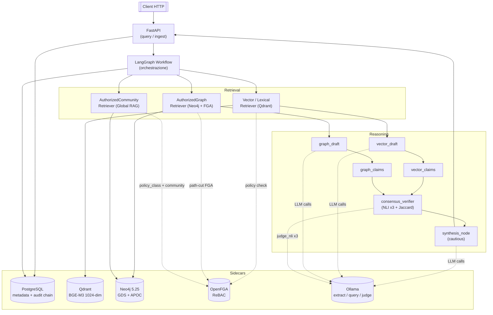
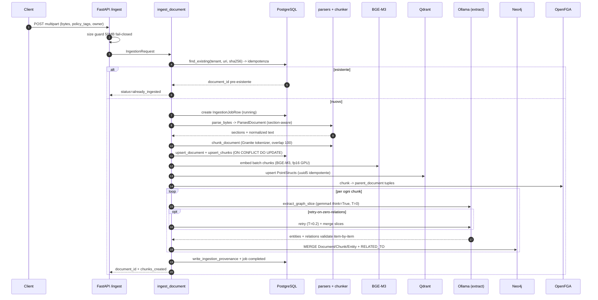
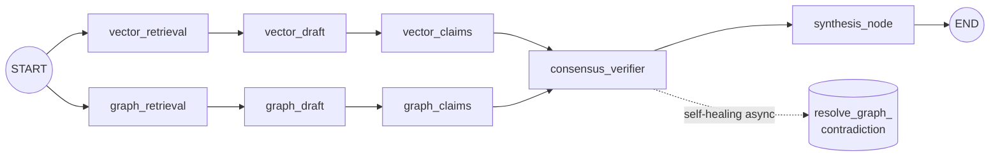

# SecureGraph RAG: Documento Tecnico di Riferimento

*Versione: alpha attiva — branch `feat/p02-baseline-harness`*

---

## 1. Sommario esecutivo

SecureGraph RAG è un framework di Retrieval-Augmented Generation ibrido vettoriale-grafo che fonde la ricerca semantica densa con la traversata di un knowledge graph sotto un modello di autorizzazione ReBAC (Relationship-Based Access Control) a grana fine, restituendo risposte simultaneamente *auditabili*, *correte rispetto al controllo accessi* e *gated dalla confidenza* calcolata via consensus cross-retriever. Il problema affrontato è duplice: i sistemi RAG standard non hanno controllo accessi nativo e i tentativi di filtrare a valle (post-retrieval ACL) sono noti per perdere informazioni via inversione di embedding, traversata di grafo e community summaries multi-classe; in parallelo, il singolo canale di retrieval non distingue le allucinazioni del retriever vettoriale da quelle del retriever grafo. I contributi principali sono tre — C1 *Verifiable Access Correctness* (ReBAC fail-closed + ledger tamper-evident), C2 *Cross-Retriever Consensus as Confidence* (verifier ensemble a 3 voti) e C3 *Policy-Partitioned Community Detection* (Louvain per classe di policy, no-leakage pinnato da property test Hypothesis), affiancati da due estensioni EXT2 (graph self-healing) ed EXT3 (gerarchia di community + Global RAG). Lo status è *alpha attivo*: tutti i milestone M0-M8 sono chiusi, cinque estensioni enterprise EXT1-EXT5 sono integrate, la suite test riporta 65/65 offline e 91/91 con backend up, il contributo C3 è in main con invariante no-leakage verde, e la branch corrente porta la P0.2 *Baseline Comparison Harness* per produrre la tabella vector-only / lexical-only / graph-only / hybrid.

---

## 2. Il problema

Una pipeline RAG standard — `chunk -> embed -> vector retrieval -> LLM` — non è sufficiente per basi di conoscenza sensibili, regolate o multi-tenant. Cinque criticità giustificano l'esistenza di SecureGraph:

1. **Assenza di controllo accessi nativo.** Il chunk vive nel vector store con il proprio embedding e payload. Filtrare le ACL *dopo* il retrieval ha già concesso al modello vettoriale (e potenzialmente ad attacchi di inversione di embedding) l'accesso a dati che il subject non poteva vedere; la traversata di grafo, in modo simmetrico, permette di ricostruire fatti vietati saltando fra nodi formalmente autorizzati ma collegati da archi la cui evidenza testuale è invece riservata.
2. **Allucinazioni mascherate dal canale singolo.** Con un solo contesto fuso, il modello non distingue se una claim viene dal vettore o dal grafo: l'LLM non ha modo di rilevare che il retriever grafo ha inventato un arco o che il retriever vettoriale ha pescato un chunk topicamente vicino ma fattualmente irrilevante.
3. **Provenance superficiale.** Le citazioni esposte all'utente non bastano a un auditor che deve *ri-derivare* che ciascuna evidenza era autorizzata al momento della richiesta, per quel subject specifico, sotto quella versione della policy.
4. **Community summaries cross-class.** I sistemi graph-RAG esistenti (GraphRAG, LightRAG, KGRAG-Ex) eseguono Louvain sull'intero grafo, generando summaries tematici che mescolano entità appartenenti a classi di permesso diverse — un leak strutturale che il filtraggio a valle non può recuperare senza distruggere il summary.
5. **Audit log mutabili.** Un operatore malintenzionato che cancelli le righe di "accesso negato" ottiene un audit log che ratifica retroattivamente l'illegittimo.

SecureGraph tratta esplicitamente il RAG come un sistema di *accesso alla conoscenza sensibile alla sicurezza*: l'autorizzazione viene imposta *prima e durante* il retrieval, non come filtro di output.

---

## 3. Architettura ad alto livello

SecureGraph è un'API FastAPI che orchestra una DAG LangGraph composta da nodi di retrieval (vector/lexical/graph) paralleli, draft cross-canale, estrazione di claim atomiche, un consensus verifier con NLI a 3 voti, e un nodo finale di synthesis cauta. I sidecar persistenti sono PostgreSQL (metadata + audit), Qdrant (vettori densi BGE-M3), Neo4j (entità, relazioni, communities), OpenFGA (decisioni ReBAC) e un runtime Ollama locale per i modelli LLM.



Il flusso è simmetricamente parallelo: i due retriever non si parlano, ciascuno produce il proprio draft e le proprie claim atomiche, e il consensus emerge solo al nodo di verifica, dove un disaccordo non genera un fallback ma alza il livello di cautela del nodo di synthesis.

---

## 4. Pipeline di ingest

L'endpoint `POST /ingest` (`src/securgraph/api/routes/ingest.py:57`) accetta upload multipart e delega a `ingest_document` (`src/securgraph/ingestion/service.py:106`), opzionalmente via coda Arq se `feature_workers_enabled` è attivo. Tutta la pipeline è racchiusa in una singola transazione Postgres di proprietà del dependency `get_db_session`: un fallimento a qualunque step *roll-back*a metadata, chunk, job e provenance. Le scritture su Qdrant e Neo4j non sono compensate, ma sono idempotenti per chiavi stabili (vedi sotto).



I quattordici step canonici del ciclo di vita sono i seguenti:

| # | Step | Cosa fa | Dove vive |
|---|------|---------|-----------|
| 1 | HTTP intake & size guard | Riceve multipart, applica budget fail-closed 50MB, parsa `policy_tags`, cattura `tenant_id`/`owner_id`/`classification` | `src/securgraph/api/routes/ingest.py:57-89` |
| 2 | Source hashing & idempotency | SHA-256 sui byte, lookup `(tenant_id, source_uri, source_hash)`; se esistente, registra `already_ingested` e ritorna senza scritture | `src/securgraph/ingestion/service.py:129-162`, `src/securgraph/indexing/postgres_writer.py:39` |
| 3 | Stable `document_id` & job row | Deriva `document_id` deterministico, crea `IngestionJobRow` in stato *running* | `src/securgraph/ingestion/service.py:164-171`, `src/securgraph/indexing/postgres_writer.py:150` |
| 4 | Parsing in sezioni | Detection format dal suffisso URI, parsing in `ParsedDocument` (Markdown heading-aware, PDF page-per-section via `pypdf`, DOCX Heading-N, TXT flat); `normalize_text` strippa control chars (hardening anti-prompt-injection) | `src/securgraph/ingestion/parsers.py:71,85`, `src/securgraph/ingestion/service.py:173-183` |
| 5 | Metadata derivation | Titolo, lingua, costruzione del Domain Model `Document` con `classification`, `owner_id`, `source_hash`, `policy_tags` | `src/securgraph/ingestion/service.py:185-200`, `src/securgraph/ingestion/metadata.py` |
| 6 | Section-aware chunking | Greedy paragraph-packing + sentence split su paragrafi oversize + overlap token-based (100 tok default); tokenizer HuggingFace `ibm-granite/granite-4.0-h-tiny`; `chunk_id = document_id_{ordinal:04d}_{sha8(text)}` | `src/securgraph/ingestion/chunker.py:135`, config `:44-53` |
| 7 | Policy binding sui chunk | `bind_chunks` stampa `classification` + `policy_tags` su ogni `Chunk` (eredità doc-level + binder rules) | `src/securgraph/ingestion/service.py:211-215`, `src/securgraph/ingestion/policy_binder.py` |
| 8 | Persistenza Postgres | `upsert_document` + `upsert_chunks` con `INSERT ... ON CONFLICT DO UPDATE` su `document_id`/`chunk_id` | `src/securgraph/indexing/postgres_writer.py:61,96` |
| 9 | Embedding BGE-M3 + Qdrant | Batch-embed con `BGEM3EmbeddingAdapter` singleton (auto mps/cuda/cpu, fp16 GPU); `PointStruct.id = uuid5(NAMESPACE_DNS, chunk_id)`; payload con `tenant_id`, `classification`, `policy_tags`; `wait=True` per integrità transazionale | `src/securgraph/indexing/qdrant_writer.py:18`, `src/securgraph/adapters/embeddings.py:31` |
| 10 | FGA chunk -> parent_document | Scrittura tuple `chunk:<id>#parent_document@document:<doc>` per abilitare la `tupleToUserset` `chunk.viewer -> document.viewer` | `src/securgraph/ingestion/service.py:308-343` |
| 11 | Graph extraction per chunk | `extract_graph_slice(text)` chiama Ollama `gemma4:e2b-it-qat` con `think=True`, `T=0.0`, JSON format; markdown-fence stripping + `json.loads`; validazione item-by-item; retry a `T=0.2` se entities>=3 ma relations==[] (~67% failure rate misurato) | `src/securgraph/adapters/ollama.py:43,89,128`, `src/securgraph/ingestion/service.py:245-247` |
| 12 | Neo4j graph slice MERGE | Singola write-tx: MERGE `Document {document_id, tenant_id}`, `Chunk {chunk_id, tenant_id}` con `classification`/`policy_tags`/`owner_id`/`direct_viewers`, `(:Document)-[:CONTAINS]->(:Chunk)`, MERGE `Entity {name, tenant_id}`, `(:Chunk)-[:MENTIONS]->(:Entity)`, MERGE `(:Entity)-[:RELATED_TO {type, source_chunk_ids}]->(:Entity)` append-only | `src/securgraph/adapters/neo4j_writer.py:16,42`, `src/securgraph/ingestion/service.py:249-256` |
| 13 | Provenance + job completion | `IngestionProvenanceRow` (versioni parser/chunker/embedder, `chunks_created`, timestamps, `status=COMPLETED`) + flip `IngestionJobRow` a *completed* | `src/securgraph/ingestion/service.py:258-279`, `src/securgraph/indexing/postgres_writer.py:203,180` |
| 14 | Community detection (deferred) | `generate_hierarchical_communities` fuori dal path di ingest: AccessLabel per chunk -> partizione per `policy_class_key` -> Louvain res=1.2 e 0.6 per bucket -> summary LLM -> Community nodes + `policy_class_key` + `HAS_SUB_COMMUNITY` intra-class; emette opzionalmente tuple FGA `policy_class` + `community#in_class` | `src/securgraph/adapters/community_generator.py:25,227`, `src/securgraph/community/policy_class.py` |

**Idempotenza end-to-end.** Re-ingest dello stesso payload è un no-op: la verifica `source_hash` corto-circuita prima di qualsiasi scrittura. Se il bypass è forzato (cambio di `source_uri`), ogni downstream è già idempotente per chiave stabile: `document_id` deterministico, `chunk_id` con SHA8 del testo, `ON CONFLICT DO UPDATE` su Postgres, `uuid5` su Qdrant, `MERGE` Neo4j con `tenant_id` nelle chiavi e `RELATED_TO.source_chunk_ids` dedup via `case-when`, e tuple FGA che logano-e-swallow `already exists`. Il tokenizer HF Granite è singleton di processo, quindi i boundary di chunking sono stabili across runs.

**Hardening recente.** Le fix in `adapters/ollama.py` (commit `be14c5e` / `547f5ab`) hanno introdotto: (i) temperature 0.0 al primo tentativo e retry a 0.2 sul fallback zero-relations; (ii) flag `llm_thinking_extract` per-ruolo, disaccoppiando l'extract dalla judge/synth; (iii) validazione item-by-item che droppa solo l'elemento malformato invece dell'intera slice. Il commit `058480f` ha aggiunto `_write_chunk_parent_tuples`: senza queste, la `tupleToUserset` non risolveva e il retrieval ReBAC-gated tornava zero contesti anche per lettori legittimi.

---

## 5. Pipeline di retrieval e consensus

L'endpoint `POST /query` invoca una DAG LangGraph i cui nodi sono definiti in `src/securgraph/orchestration/workflow.py`. Le quattro modalità di retrieval sono cablate via `options.retrieval_mode`; ciascuna modalità accende o spegne i branch della DAG senza alterarne la topologia.

| Modalità | Comportamento | Riferimenti |
|----------|---------------|-------------|
| `vector` | Solo dense embedding su Qdrant; lessicale skipped; graph branch no-op | `workflow.py:111-115`, `vector_retriever.py:27-67`, `workflow.py:154-156` |
| `lexical` | Solo full-text Qdrant `MatchText` multilingual, score flat 1.0; dense bypassato; graph branch no-op | `workflow.py:111-113`, `vector_retriever.py:69-112`, `workflow.py:155-156` |
| `graph` | Solo Neo4j: vector branch ritorna vuoto; seed extraction da catalogo entità + path-cut FGA | `workflow.py:102-103,162-166`, `graph_retriever.py:103-184` |
| `hybrid` | Default: dense + lexical fusi via RRF (k=60) e traversata grafo autorizzata in parallelo da START | `workflow.py:94-96,393-394`, `fusion.py:18-80` |

### 5.1 La DAG LangGraph



I nodi sono divisi in coppie simmetriche per canale:

- **`vector_retrieval`** (`workflow.py:98-123`) — esegue `qdrant.search_dense` (skip in modalità lexical) e `qdrant.search_lexical`, poi `fuse_rankings` RRF; scrive `vector_context`. No-op se `query_type=global` o `mode=graph`.
- **`graph_retrieval`** (`workflow.py:125-178`) — per `query_type=global` invoca `AuthorizedCommunityRetriever.retrieve_communities` (Level 1) e scrive i summary direttamente in `graph_context` *e* in `graph_draft`; altrimenti estrae i seed dal catalogo entità via `_extract_seeds_from_catalog` e chiama `traverse_authorized_subgraph`. No-op in `vector`/`lexical`.
- **`vector_draft`** / **`graph_draft`** (`workflow.py:180-201, 203-224`) — concatenazione del rispettivo context in un prompt e generazione del draft via Ollama (`settings.llm_model = nemotron-3-nano:4b`, think=False).
- **`vector_claims`** / **`graph_claims`** (`workflow.py:226-254`) — `extract_claims` decompone ciascun draft in `Claim` atomiche con `verifier_status=NOT_CHECKED`.
- **`consensus_verifier`** (`workflow.py:256-339`) — fan-in dei due canali (vedi §5.3).
- **`synthesis_node`** (`workflow.py:341-380`) — produce la risposta finale.

### 5.2 Seed extraction e path-cut FGA

`_extract_seeds_from_catalog` (`workflow.py:30-72`) esegue una Cypher `MATCH (e:Entity) WHERE e.tenant_id=$tid RETURN e.name` per ottenere il catalogo entità del tenant, poi applica matching bidirezionale case-insensitive: per ogni nome di catalogo lo include se `name.lower() in query.lower()` *oppure* se un qualunque token della query (stripped di `,.?!:;()[]\"'`, len>=3) compare in `name.lower()`. Su errori infrastrutturali o catalogo vuoto, fallback a `_heuristic_seeds` (parole capitalized). I seed vengono passati a `traverse_authorized_subgraph` con `max_depth=2`.

Il **path-cut FGA** (`AuthorizedGraphRetriever`, `graph_retriever.py:103-184`) è il meccanismo che distingue SecureGraph dagli altri sistemi graph-RAG: (1) Neo4j materializza i path raw con `elementId(rel)` e `rel.source_chunk_ids` per arco; (2) `AuthorizedGraphRetriever` re-interroga Neo4j per i `source_chunk_ids` di tutti gli edge raccolti; (3) batch-fetch dei Chunk da Postgres via `fetch_chunks_by_ids`; (4) `OpenFGAPolicyAdapter.filter_chunks` valuta in parallelo le `ClientCheckRequest` e ritorna `authorized_ids`; (5) per ogni path si itera sugli archi in ordine: se *un solo* arco ha tutte le `source_chunk_ids` non autorizzate, l'intero path viene scartato (`break` su primo unauthorized). Il `path.text` finale è ricomposto solo dai testi dei chunk autorizzati. *L'innovazione chiave è il taglio a livello di evidenza dell'arco, non del nodo*: una catena di entità tutte autorizzate viene comunque cut non appena un singolo chunk-supporto è negato, impedendo la ricostruzione di fatti vietati per stitching di vicini autorizzati.

### 5.3 Consensus: dual-draft + agreement_score + verifier ensemble

Il `consensus_verifier_node` (`workflow.py:256-339`) cross-verifica i due canali via NLI bidirezionale: per ogni `Claim` vettoriale chiama `judge_nli(claim.text, graph_draft)`; per ogni claim grafo chiama `judge_nli(claim.text, vector_draft)`. Le label vengono mappate a `VerifierStatus.SUPPORTED` se `entailment`, altrimenti `UNSUPPORTED`. L'estrazione delle entità (per il termine Jaccard) è una bag-of-words crude: token lowercase len>4 strippati di `,.?!`.

La funzione di consensus (`domain/consensus.py:64-105`) è:

```
jaccard      = |V intersect G| / |V union G|       (1.0 se entrambe vuote)
nli_score    = entailed_total / claims_total       (1.0 se nessuna claim)
agreement    = 0.4 * jaccard + 0.6 * nli_score
high_trust   = agreement >= threshold              (default 0.7)
```

Il verifier `judge_nli` è il **3-voter majority ensemble** (EXT4): tre chiamate Ollama in parallelo via `asyncio.gather` (`src/securgraph/adapters/ollama.py`), majority vote sui label — un singolo voter allucinante non può ribaltare il verdetto. La sintesi cauta non è una branch di codice ma un'istruzione di sistema al `synthesis_node` (`workflow.py:374`): *"if there is no agreement and the score is below the threshold, warn that agreement could not be reached and synthesize a cautious minimal response"*. Il limite di questo design (hedge single-channel) è discusso in §10.

**Self-healing (EXT2).** Se `feature_self_healing_enabled` e una qualsiasi graph claim ha `NLILabel.CONTRADICTION`, viene spawnato `asyncio.create_task(resolve_graph_contradiction)` fire-and-forget (`workflow.py:310-335`): un LLM judge in background riconcilia gli archi KG contro il ground-truth vettoriale e flagga/ripara via il counter Prometheus `securgraph_graph_self_healing_total`.

### 5.4 Global RAG (EXT3)

Quando `options.query_type == 'global'` il flusso si specializza: `vector_retrieval` ritorna context vuoto, `graph_retrieval` invoca `AuthorizedCommunityRetriever.retrieve_communities(subject, level=1)`, che esegue (a) Cypher su `(c:Community {tenant_id})` con `c.level=1`; (b) `authorized_classes` — una `ClientCheckRequest` per ciascun `policy_class_key` distinto (`policy_class:<key>#viewer`), il *gate fast path*; (c) `filter_communities` — secondo check defense-in-depth per `community:<id>#viewer`. Entrambi i check fail-closed su eccezione. I summary autorizzati formatati come `--- Community Cluster i: title (Level L) --- Summary: ... Members: ...` vengono scritti in `graph_context` *e* `graph_draft`. I nodi downstream sono short-circuited: claim-extraction vuota, consensus `None`, `synthesis_node` prende la branch globale (`workflow.py:347-363`) con un system prompt da "global synthesis agent" istruito esplicitamente a non estrapolare. Poiché `consensus_report` è `None`, `query.py:117-124` lascia `high_trust=False` e i campi numerici di confidenza a `None`.

---

## 6. Sicurezza e auditing

Il modello ReBAC OpenFGA (`docker/openfga/model.fga`, bootstrap programmatico in `src/securgraph/api/dependencies.py:99-175`) definisce i seguenti tipi e relazioni.

| Tipo | Relazione | Semantica |
|------|-----------|-----------|
| `group` | `member` | Membership utente o gruppo nidificato; supporta risoluzione ricorsiva `group -> member -> user` |
| `document` | `owner` | Proprietario diretto del documento; ingestion seed da `request.owner_id` |
| `document` | `group_viewer` | Userset `group:G#member` come viewer |
| `document` | `direct_viewer` | Singolo utente named come viewer |
| `document` | `viewer` | Union computata di `owner` ∪ `group_viewer` ∪ `direct_viewer` — l'unica relazione effettivamente checkata al retrieval |
| `chunk` | `parent_document` | `chunk:<id>#parent_document@document:<doc>` scritto dall'ingestion |
| `chunk` | `viewer` | `tupleToUserset`: viewer di chunk iff viewer del `parent_document` — propagazione ACL senza tuple per-chunk |
| `community` (implicito) | `viewer` | Check dinamico su `community:<id>#viewer` (defense-in-depth in `AuthorizedCommunityRetriever`) |
| `policy_class` (implicito) | `viewer` | Gate per classe di policy — un check ammette l'intera community con quel `policy_class_key` |

### 6.1 Flusso di decisione

Il retrieval identifica i `chunk_id` candidati (vector/lexical/graph paths). `OpenFGAPolicyAdapter.filter_chunks(subject, chunks, trace_id)` (`domain/policy.py:78-144`) emette una `ClientCheckRequest` per chunk *in parallelo* via `asyncio.gather`: `user=subject.fga_user`, `relation='viewer'`, `object=f'chunk:{chunk_id}'`. OpenFGA valuta la `tupleToUserset` `chunk.viewer -> document(parent_document).viewer -> owner ∪ group_viewer ∪ direct_viewer`, camminando ricorsivamente `group.member`. Per ogni check viene costruito un `PolicyDecision` con `decision=ALLOW|DENY`, `reason_code='openfga_ok'` o `'unauthorized_rbac'`, e il counter Prometheus `POLICY_DECISION_COUNT` viene incrementato. `AuthorizedGraphRetriever` persiste il batch completo via `write_policy_decisions` (`indexing/graph_retriever.py:155-159`). Le communities passano per il gate a due stadi `policy_class -> community`.

### 6.2 Fail-closed

Ogni chiamata FGA è wrappata in `try/except`; su qualunque eccezione `allowed=False` viene forzato e una riga `PolicyDecision` con `decision=DENY`, `reason_code='unauthorized_rbac'` viene comunque registrata (`domain/policy.py:93-122`). Identico pattern in `AuthorizedCommunityRetriever`: `policy_class_check_failed_failing_closed` e `openfga_check_failed_failing_closed` (`global_retriever.py:102-108, 137-143`). Effetto netto: outage OpenFGA, problemi di rete, tuple mancanti o risposte malformate *collassano sempre a DENY con audit row* — mai a ALLOW. Il contratto fail-closed è documentato nel docstring di `OpenFGAPolicyAdapter`.

### 6.3 Pezzi di audit

| Artefatto | Contenuto | Origine |
|-----------|-----------|---------|
| `PolicyDecision` | Una riga per check `(subject, object, action)` con `decision_id`, `trace_id`, `tenant_id`, `user_id`, `object_type`, `object_id`, `action`, `decision`, `reason_code`, `policy_engine='openfga'`, `evaluated_at`, `tamper_hash` opzionale. `ON CONFLICT DO NOTHING` per idempotenza | `domain/policy.py:41-65`, `indexing/postgres_writer.py:233-261` |
| `RetrievalEvidence` | `policy_check_id` (FK alla decision), `retriever_id` (vector/lexical/graph/community), `included_in_prompt`, rank e score fusi/originali | `domain/retrieval.py:30-67` |
| `IngestionProvenance` / `IngestionTrace` | Versioni di parser/chunker/embedder/extractor, `source_hash`, `chunks_created` per `trace_id` | `indexing/postgres_writer.py:203-220` |
| `QueryTrace` | Trace request-level con `query`, `answer`, latency, timestamps, HMAC-chained | `indexing/db.py`, `tamper.py:118-148` |
| `POLICY_DECISION_COUNT` | Counter Prometheus con label `tenant_id`, `object_type`, `decision` per dashboard operative | `domain/policy.py:125-132`, `global_retriever.py:147-154` |
| Log structlog | `Access denied to chunk`, `OpenFGA check failed, failing closed`, `fga_chunk_parent_tuple_write_failed`, correlati per `trace_id` | various |

### 6.4 Tamper-evidence (EXT5)

Le tabelle `policy_decisions`, `query_traces` e `evidence_chunks` sono linkate in una **catena hash SHA-256** con sentinella GENESIS e isolamento per tenant (`src/securgraph/indexing/tamper.py`, migrazione Alembic `e0f1aa805a88`). Un auditor può ri-derivare due proprietà: (i) ogni evidenza citata era autorizzata al momento della richiesta per quel subject; (ii) il log stesso non è stato manomesso ex post. Manomissione di una riga rompe la catena per tutte le righe successive del tenant.

### 6.5 La promessa C3 (Policy-Partitioned Communities)

`Community` è un `Pydantic` model con campo obbligatorio `policy_class_key: str` (default `'unlabeled'`) (`domain/community.py:10-19`). Le community sono clusterizzate *separatamente per classe* via il sotto-grafo definito dalla partizione `partition_edges_by_class` su `AccessLabel(owner, group_viewers, direct_viewers)`, per cui un singolo `Community` node contiene per costruzione solo entità con lo stesso `policy_class_key` — nessuna community può per design attraversare classi di policy. Al retrieval, `AuthorizedCommunityRetriever.retrieve_communities` emette un check FGA per `policy_class_key` distinto e droppa ogni community la cui classe non è viewable, applicando poi il check per-community come defense-in-depth. La proprietà di no-leakage è pinnata da un property test Hypothesis sotto `tests/adversarial/test_c3_no_leakage.py`. È il contributo originale che distingue SecureGraph da GraphRAG / LightRAG / KGRAG-Ex.

---

## 7. Stack tecnologico

| Componente | Ruolo | Versione |
|------------|-------|----------|
| Python | Runtime produzione + harness eval isolato | >=3.11 |
| FastAPI | API HTTP per `/query` e `/ingest` | >=0.115 |
| Uvicorn | Server ASGI | >=0.32 |
| Pydantic | Domain models + request/response validation | >=2.7 |
| pydantic-settings | Config tipizzata da `.env` (prefix `SECURGRAPH_*`) | >=2.5 |
| httpx | Client HTTP async (integrazioni + OTel instrumentation) | >=0.27 |
| SQLAlchemy | ORM/Core asyncio per metadata, provenance, audit | >=2.0 |
| Alembic | Migrazioni schema Postgres | >=1.13 |
| asyncpg | Driver Postgres async dietro SQLAlchemy | >=0.29 |
| PostgreSQL | Metadata + provenance + audit chain + datastore OpenFGA condiviso | 16-alpine |
| Qdrant | Vector store denso (BGE-M3, 1024-dim) | v1.12.4 |
| Neo4j | Knowledge graph (entità, relazioni, communities) | 5.25-community + GDS + APOC |
| OpenFGA | Servizio ReBAC; `ClientCheckRequest` al retrieval | v1.8.0 |
| Redis | Coda Arq + decision cache + LangGraph checkpointer | 7-alpine |
| Jaeger | OTLP collector + UI traces | latest |
| OpenTelemetry SDK + OTLP | Tracing/metrics per FastAPI, httpx, asyncpg | >=1.27 |
| prometheus-client | Endpoint metriche su `SECURGRAPH_METRICS_PORT=9464` | >=0.21 |
| structlog | Logging JSON strutturato | >=24.4 |
| Ollama | Runtime LLM locale per extract/query/synth/judge | >=0.4 |
| FlagEmbedding (BGE-M3) | Embeddings densi a ingest e query time | >=1.3 |
| transformers (HF AutoTokenizer) | Token budgeting via `ibm-granite/granite-4.0-h-tiny` | >=4.45 |
| LangGraph | DAG di orchestrazione | >=0.2.40 |
| langchain-core | Primitivi Message/Runnable consumati da LangGraph | >=0.3 |
| LangChain + langchain-community | Wrappers RAGAS isolati (solo `/eval`) | >=0.3,<1.0 |
| RAGAS | Harness KPI offline | >=0.2,<0.5 |
| datasets / pandas / matplotlib | Manipolazione risultati eval + plot | datasets>=3.0, pandas>=2.2, matplotlib>=3.9 |
| arq | Task queue async per worker e orchestrazione eval | >=0.28 / >=0.26 |
| Hatchling | Build backend PEP-517 | n/a |
| uv | Resolver dipendenze; eval pulla `securgraph` come editable path-dep | n/a |
| Ruff | Lint + format (regole E/W/F/I/B/UP/SIM/RUF/ASYNC/S) | >=0.7 |
| mypy | Static typing; strict su `securgraph.domain.*` | >=1.13 |
| pytest + pytest-asyncio + pytest-cov + hypothesis | Unit, integration, adversarial | 8.3 / 0.24 / 5.0 / 6.115 |

---

## 8. Scelte dei modelli

L'audit di modelli condotto sull'extract task (5 documenti ground-truth) ha prodotto il seguente ranking, ordinato per `recall_mean`:

| Combo | parse_ok_rate | recall_mean | recall_stdev | n_relations_mean | latency_mean (s) |
|-------|---------------|-------------|--------------|------------------|------------------|
| `gemma4:e2b-it-qat` think=True | 1.000 | 0.869 | 0.132 | 8.000 | 22.012 |
| `gemma4:e2b-it-qat` think=False | 1.000 | 0.777 | 0.144 | 11.667 | 28.335 |
| `granite4.1:3b` think=False | 1.000 | 0.681 | 0.190 | 6.600 | 61.810 |
| `qwen3.5:2b` think=False | 0.867 | 0.677 | 0.118 | 8.769 | 108.991 |
| `nemotron-3-nano:4b` think=True | 1.000 | 0.572 | 0.246 | 6.133 | 269.768 |

Da questi numeri deriva il setup multi-ruolo:

| Ruolo | Modello | Thinking | num_ctx | Motivazione |
|-------|---------|----------|---------|-------------|
| extract (offline) | `gemma4:e2b-it-qat` | True | 4096 | Vincitore audit con 0.869 recall e 22.0s di latency; JSON-schema strict è fragile sui modelli piccoli senza reasoning interno, quindi `think=True` qui anche se altrove è disabilitato |
| query / synth (vector_draft, graph_draft, synthesis) | `nemotron-3-nano:4b` | False | 4096 | Smoke B mostra ~15s di /query latency mediana; `think=True` su nemotron è esploso a 269.8s nell'audit con recall 0.572 |
| judge_nli (verifier interno) | `nemotron-3-nano:4b` | False | 4096 | Condivide i pesi runtime già caricati per la query, niente eviction VRAM su hardware minimale |
| RAGAS evaluation judge (offline isolato) | `qwen3.5:2b` | False | 16384 | Famiglia diversa dal judge di produzione per soddisfare P1.4 (judge independence); ctx grande per i prompt RAGAS multi-turn |
| RAGAS evaluation embeddings | `nomic-embed-text` | n/a | n/a | Famiglia diversa da BGE-M3 in modo che la similarity in eval non sia misurata dall'encoder usato per il retrieval |
| Dense embeddings (prod ingest + query) | `BAAI/bge-m3` | n/a | n/a | Multilingue, 1024-dim, allineato alla collection Qdrant |
| Chunker tokenizer (token budgeting) | `ibm-granite/granite-4.0-h-tiny` | n/a | n/a | Vocabolario vicino alla famiglia granite4.1, stabile across runs |

### 8.1 Perché tre modelli e non uno

Si usano deliberatamente tre LLM differenti perché ciascun ruolo ha una *funzione obiettivo non-overlapping* che i dati di audit dimostrano essere non congiuntamente massimizzabile da nessun singolo modello su hardware minimale Ollama.

1. **extract** è un task JSON-schema dove la metrica di interesse è la *recall media* sul ground truth: `gemma4` think=True vince a 0.869 / 22.0s e `parse_ok=1.0`; `nemotron` think=True collassa a 0.572 / 269.8s; `granite4.1:3b` sta a 0.681 / 61.8s. Nessuna riconciliazione possibile su un singolo modello.
2. **query/synth/judge_nli** è un path online *latency-bound* con SLO ~10-15s p50: `nemotron-3-nano:4b` think=False raggiunge ~15s mediana; abilitare il thinking costa 269s nell'audit, fuori SLO.
3. **RAGAS evaluation judge** *deve* essere indipendente dal judge di produzione per soddisfare il requisito di ricerca P1.4: usare lo stesso modello per produrre e valutare introduce bias di self-preference e invalida il KPI. Si è scelto `qwen3.5:2b` (famiglia diversa da `nemotron`) in venv isolato (`eval/pyproject.toml`) in modo che la dependency `langchain<1.0` non leak nel lock di produzione.

Il tradeoff è *complessità operativa* (tre model pull in Ollama, due progetti Python) contro *validità di misurazione + compliance SLO*. I numeri dell'audit dimostrano che il collasso a un singolo modello costerebbe alternativamente ~30 punti di extract recall, ~10x di query latency, o l'indipendenza del judge: nessuno dei tre accettabile per un sistema che dichiara *trustworthy RAG*.

---

## 9. Valutazione

L'harness di valutazione vive nel sotto-progetto isolato `eval/` con il proprio `pyproject.toml` e `uv.lock` (INFRA-1), separato dal lock di produzione per evitare che `langchain<1.0` (richiesto da RAGAS) contamini la build runtime.

### 9.1 Metriche RAGAS

| Metrica | KPI target |
|---------|------------|
| Faithfulness | >= 0.85 |
| Answer relevance | (non specificato in modo numerico, parte della rubrica) |
| Context precision | >= 0.75 |
| Context recall | >= 0.70 |
| Multi-hop correctness | >= 0.70 |

Affiancate da **hard security gates** (zero-tolerance):

- Unauthorized evidence in prompt = **0 occorrenze**
- Cross-tenant leakage = **0 occorrenze**
- Provenance coverage = **100%** degli answer (ogni answer ha `trace_id`)
- Citation coverage >= 95% degli answer fattuali
- P95 query latency < 8 s su dataset MVP, P95 simple-QA < 4 s
- Ingestion consistency = 0 chunk orfani
- Policy regression tests = 100% passing prima di ogni release
- Invariante no-leakage C3 pinnato da property test Hypothesis (`tests/adversarial/test_c3_no_leakage.py`)

### 9.2 Corpus baseline e 4-mode harness

Il corpus `baseline_v1` ospita 5 documenti (HR policy, contratti servizio, manuale sicurezza, verbali di riunione, estratti regolamentari) e 30 coppie QA con ground truth. La P0.2 *Baseline Comparison Harness* (branch corrente `feat/p02-baseline-harness`) wirea `retrieval_mode` end-to-end attraverso il workflow LangGraph in modo che `eval/baseline.py` possa generare **numeri side-by-side per le quattro modalità** (`vector` / `lexical` / `graph` / `hybrid`) sullo stesso golden corpus.

Status della P0.2 al momento di stesura:

- Task 1 (workflow `retrieval_mode` wiring) — done
- Task 2 (`eval/baseline.py` scaffold) — done
- Task 3 (draft 5 doc + 30 QA) — in corso, attesa review utente
- Task 4 (real run + wiki doc) — bloccato su accept Task 3

I commit recenti hanno aggiunto un wrapper judge basato su Qwen, una fixture di DB wipe e uno script `eval/extract_audit.py` per la valutazione rigorosa di P1.4 *judge independence*.

### 9.3 Judge independence (P1.4)

Requisito di valutazione: il judge NLI usato per misurare l'agreement non deve essere lo stesso modello che produce gli answer, altrimenti la metrica è circolare. Il wrapper Qwen (commit `be14c5e`) decouple il judge eval da quello di pipeline: il pipeline usa `nemotron-3-nano:4b`, l'eval usa `qwen3.5:2b`. Lo stesso principio si applica agli embeddings di eval (`nomic-embed-text` vs `BAAI/bge-m3` di produzione).

---

## 10. Limitazioni e lavori futuri

**Limitazioni note.**

1. **Cautious-synthesis hedge a canale singolo.** Quando `agreement_score < threshold`, la fallback cauta è imposta come *system prompt instruction* al `synthesis_node` (`workflow.py:374`), non come branch di codice. Conseguenza: la cautela dipende dall'aderenza dell'LLM all'istruzione di sistema; non c'è una garanzia strutturale che la risposta venga effettivamente abbassata. Una versione futura potrebbe materializzare due percorsi di synthesis distinti (full / minimal-cautious) e selezionarli in codice in base allo score.
2. **JSON-fragility dei piccoli LLM nell'extract.** Anche con `think=True`, il task di extract ha mostrato un failure mode di "entities ma zero relations" misurato a ~67% sull'audit `eval/results/extract_audit_20260611T105341Z.json`. La fix retry-on-zero-relations a `T=0.2` mitiga ma non elimina; la produzione di JSON strict da modelli <5B è strutturalmente fragile.
3. **Partial-write recovery cross-store.** La transazione end-to-end è Postgres-bound: Qdrant e Neo4j vengono scritti dentro la stessa sessione ma non sono partecipanti veri di una 2PC. Un fallimento dopo la write Neo4j non compensa Qdrant / Neo4j; il recovery si appoggia all'idempotenza per chiavi stabili al re-ingest successivo.
4. **Community detection out-of-band.** Step 14 (Louvain + summaries) non è sul path di ingest: deve essere triggerata da uno script operator o da un refresh in query-time. Il drift fra grafo aggiornato e community stale è una proprietà operativa, non strutturale.
5. **`high_trust=False` forzato in Global RAG.** Per query type `global`, `consensus_report=None` e quindi i campi numerici di confidenza esposti via `QueryResponse` restano `None` e `high_trust=False`. La fiducia delle risposte globali oggi è una *funzione del solo path C3-authorized*, senza un agreement score quantitativo.

**Lavori futuri / status differito.**

- **P1.3** (model-substitution test) — pianificato.
- **P1.4** (judge independence finalized + documentato) — wrapper Qwen landed in `be14c5e`; documentazione end-to-end ancora da chiudere.
- **D7** — pilot validation report.
- **D8** — deployment guide.
- **Frontend Next.js + react-flow** — esplicitamente deferred.
- **Release v0.1.0 Apache-2.0** — taggata dopo D7/D8.

### Riferimenti chiave nel repository

- `README.md`

---

*Documento generato sullo stato della branch `feat/p02-baseline-harness` al 2026-06-18.*
