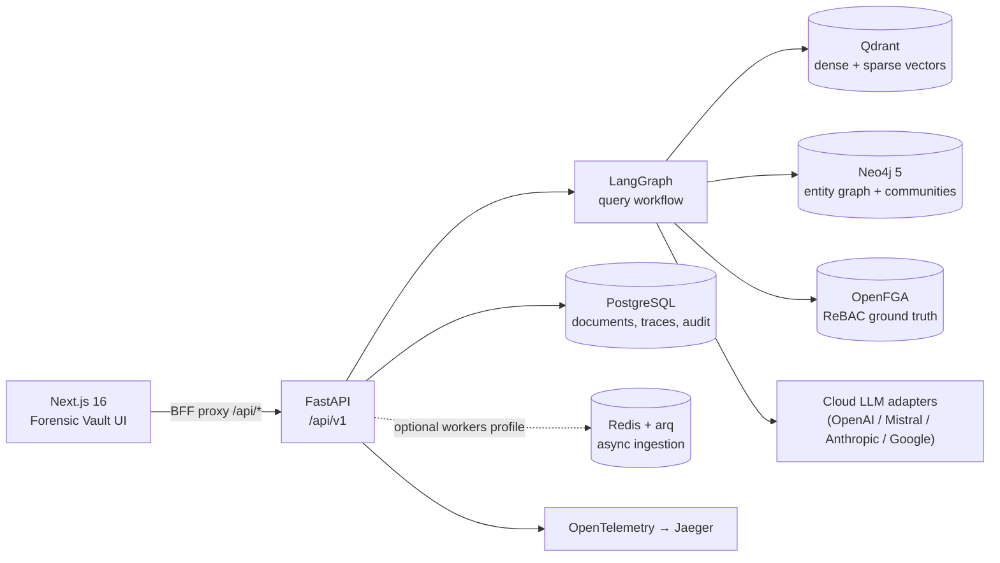

# SecureGraph — Technical Overview

**Version:** 0.1.0a0 (alpha) · **Audience:** engineers, integrators, security reviewers · **Author:** Stefano Hernandez

SecureGraph is a hybrid vector-graph Retrieval-Augmented Generation (RAG) framework designed for environments where every answer must be traceable to authorized evidence. It combines dense/sparse vector search (Qdrant) and knowledge-graph traversal (Neo4j) behind a relationship-based access control layer (OpenFGA), and makes three guarantees that conventional RAG stacks do not:

| Guarantee | Meaning | Mechanism |
| --- | --- | --- |
| **C1 — Verifiable access correctness** | An auditor can re-derive, after the fact, that every chunk, node, and edge used as evidence was authorized for the requesting subject at query time. | Per-decision `PolicyDecision` rows, HMAC-SHA256 tamper-evident hash chain over query traces, periodic Merkle-root anchoring to S3 Object Lock, `/explain` replay endpoint. |
| **C2 — Cross-retriever consensus** | The system reports *how much* independent retrieval channels agree before an answer is labeled trustworthy. | Vector and graph lanes run independently on authorized evidence; agreement = 0.4 · entity-set Jaccard + 0.6 · bidirectional NLI over decomposed claims (3-voter ensemble); a code-level synthesis verdict (`decide_synthesis`) gates the answer style. |
| **C3 — Policy-partitioned communities** | Graph community summaries never mix content across access boundaries. | The tenant graph is partitioned by policy-equivalence class (canonical hash of `owner + group_viewers + direct_viewers`) *before* Louvain community detection; a Hypothesis property test pins the no-leakage guarantee. |

## What SecureGraph is / is not

**It is:**

- A reference implementation of trustworthy hybrid RAG: FastAPI backend, LangGraph query orchestration, Next.js operator UI ("Forensic Vault").
- Multi-tenant by construction: tenant scoping is enforced server-side (session-derived identity, PostgreSQL row-level security, per-tenant FGA tuples).
- Evidence-grade: failed queries leave audit traces too; permission grants/revokes are audited; the audit ledger is tamper-evident.

**It is not:**

- A drop-in vendor-agnostic library. The default backends (Qdrant, Neo4j, OpenFGA, BGE-M3) are wired through adapter protocols, but only these implementations exist today.
- A production-hardened product. It is an alpha research framework; see [Deployment](07-deployment.md) for the production checklist and known gaps.
- A learned-routing system. Query routing between vector/graph/hybrid modes is heuristic (`auto_route`), not trained.

## System at a glance



The full component breakdown is in [Architecture](01-architecture.md).

## Glossary

| Term | Definition |
| --- | --- |
| **Chunk** | A token-budgeted slice of an ingested document; the unit of vector retrieval and of authorization evidence. |
| **Policy-equivalence class** | The set of graph nodes/chunks sharing an identical access profile (same owner, group viewers, direct viewers). C3 partitions communities inside these classes. |
| **Path-cut pruning** | Graph-retrieval rule: a traversal path is cut at the first edge whose `source_chunk_ids` are not fully authorized for the subject. |
| **Consensus score** | `0.4 · jaccard(entity sets) + 0.6 · NLI agreement` between the vector-lane and graph-lane drafts. |
| **Synthesis verdict** | One of four code-level branches (`direct`, `single_channel`, `cautious`, `no_evidence`) chosen by `decide_synthesis` from evidence presence and consensus — never left to the LLM prompt. |
| **Tamper chain** | Per-tenant HMAC-SHA256 hash chain linking each query trace to its predecessor; any rewrite breaks verification. |
| **Merkle anchor** | A periodic Merkle root over audit rows written to S3 Object Lock (WORM), giving external verifiability without per-event external writes. |
| **Trace / trace_id** | The persisted audit record of one query: retrieval evidence, policy decisions, consensus, answer, chain hash. Input to `/explain`. |
| **MRD corpus** | The 50-case evaluation suite (`corpus/mrd_v1`): 17 pseudonymized documents, 8 personas, 10 groups, 4 classification levels, 37 allow / 13 deny cases. |
| **Eval identity mode** | Dev/test-only flag (`SECURGRAPH_EVAL_IDENTITY_MODE`) allowing the caller to simulate a subject for read-only authorization evaluation. Refused in production. |

## Document map

| Document | Read it when you need… |
| --- | --- |
| [01 — Architecture](01-architecture.md) | The component/container view, layer responsibilities, technology choices. |
| [02 — Data Model](02-data-model.md) | PostgreSQL schema, Qdrant collections, Neo4j graph model, OpenFGA authorization model, migrations. |
| [03 — API Reference](03-api-reference.md) | Every `/api/v1` endpoint, authentication, CSRF, rate limits, error semantics. |
| [04 — Query Pipeline](04-query-pipeline.md) | The LangGraph workflow node by node: routing, parallel retrieval, consensus, synthesis verdict, trace persistence. |
| [05 — Ingestion](05-ingestion.md) | Upload → parse → chunk → embed → graph extraction → FGA tuples; sync vs async; self-healing. |
| [06 — Security Model](06-security-model.md) | Threat model and every enforcement mechanism (C1/C2/C3, tamper chain, RLS, SSRF guard, rate limiting, startup guards). |
| [07 — Deployment](07-deployment.md) | Docker Compose profiles, configuration surface, health endpoints, production checklist. |
| [08 — Development](08-development.md) | Environment setup, test taxonomy, CI, conventions, how to contribute. |
| [09 — Evaluation](09-evaluation.md) | The MRD corpus, scoring methodology, current results, how to reproduce. |

## Quick start

Follow the [README quickstart](../../README.md#quickstart) (env → `make venv` → `make up` → `make migrate` → bootstrap super-admin → `make api` + `make web-dev`). [Deployment](07-deployment.md) covers the same flow with operational detail.

## Repository layout

```text
src/securgraph/
  domain/           Pydantic lingua-franca models
  adapters/         Protocol-based backends (LLM, Neo4j, Qdrant, Postgres, …)
  ingestion/        Parsers, chunker, async worker, self-healing
  indexing/         Store writers/retrievers, tamper chain
  community/        C3 policy-equivalence-class partitioning
  orchestration/    LangGraph query workflow
  provenance/       Trace assembly for /explain
  security/         AES-GCM credential encryption
  api/              FastAPI routes, middleware, dependencies
tests/{unit,integration,adversarial}/
corpus/mrd_v1/      Evaluation corpus (manifest, QA pairs, artifacts)
eval/               Evaluation harness (isolated venv) + results
web/                Next.js Forensic Vault UI
docs/technical/     This documentation set
docs/research/      Model configuration notes
wiki/               Internal engineering wiki (agent-maintained)
```
