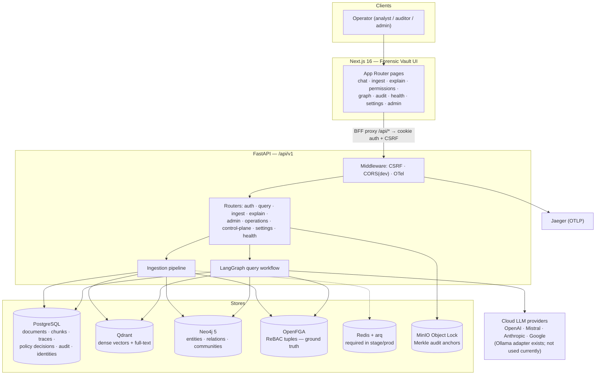
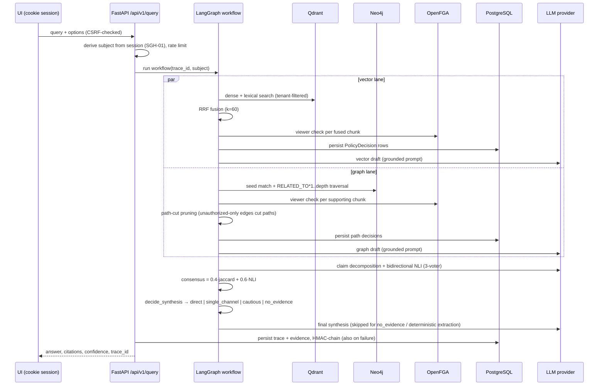
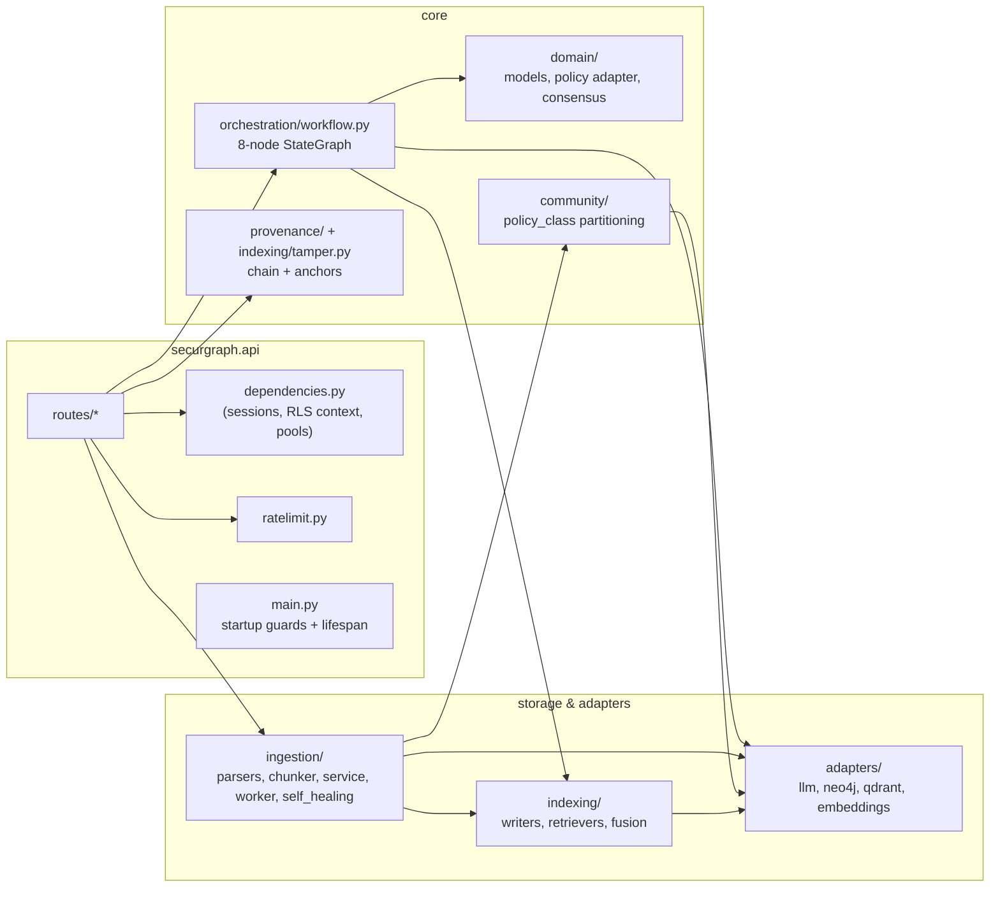

# 01 — Architecture

SecureGraph is a three-tier system: a Next.js operator UI, a FastAPI backend that owns all security decisions, and a set of specialized datastores coordinated by a LangGraph query workflow. The design rule that shapes everything: **no security decision is ever made client-side, and every retrieval-time decision is persisted for later audit.**

## System context

## Layer responsibilities

| # | Layer | Technology | Responsibility |
| --- | --- | --- | --- |
| 1 | API | FastAPI + Pydantic v2 | Versioned REST under `/api/v1`; request validation; rate limiting; startup guards. |
| 2 | AuthN | HttpOnly cookie sessions, JWT access + rotating refresh, CSRF double-submit | Who is calling. Identity is always derived server-side from the session. |
| 3 | AuthZ | OpenFGA (ReBAC) | Whether each *evidence object* is visible to the subject. Ground truth for C1; fail-closed on any error. |
| 4 | Vector store | Qdrant (dense 1024-dim BGE-M3, cosine) + payload full-text index | Semantic and lexical chunk retrieval, hard-filtered by `tenant_id`. |
| 5 | Graph store | Neo4j 5 | Entity-relationship traversal (`RELATED_TO*1..4`), Louvain communities partitioned per policy class (C3). |
| 6 | Orchestration | LangGraph `StateGraph` | Parallel vector ‖ graph lanes → drafts → claims → NLI consensus → code-level synthesis verdict. |
| 7 | LLM + embeddings | Provider adapters (OpenAI/Mistral/Anthropic/Google/Ollama) + local FlagEmbedding BGE-M3 | Generation, extraction, and NLI judging via per-stage configurable providers; embeddings computed locally (no egress). |
| 8 | Observability + audit | OpenTelemetry → Jaeger, Prometheus metrics, HMAC tamper chain + Merkle anchors | Every query leaves a verifiable trace; metrics for queries, consensus, policy decisions, self-healing. |

## The query path (container view)

One `POST /query` touches every layer:

Details node-by-node: [04 — Query Pipeline](04-query-pipeline.md).

## Component view (backend packages)

Package rule of thumb: `domain/` holds vendor-neutral models and protocols; `adapters/` are the only modules that import vendor SDKs; `indexing/` composes adapters into authorized writers/retrievers; `orchestration/` and `ingestion/` are the two pipelines; `api/` is transport only.

## Key architectural decisions

| Decision | Rationale | Trade-off accepted |
| --- | --- | --- |
| **OpenFGA as the single authorization ground truth**, checked per evidence object at query time (fail-closed) | C1 requires re-derivable decisions; a cached/denormalized ACL could drift from the source of truth. | One `check` per object (concurrent `asyncio.gather`, not FGA BatchCheck) adds latency on large evidence sets. |
| **Authorization filtering happens post-retrieval, pre-prompt** (not as store-level filters) | The decision must be recorded per object with a reason code; a pre-filter would hide denials from the audit trail. | Retrieves candidates it may then drop. |
| **Synthesis verdict in code, not in the prompt** (`decide_synthesis`) | An LLM asked "refuse if unsure" refuses unpredictably; four explicit branches make refusal at high agreement impossible by construction. | Less prompt flexibility. |
| **Policy partition before Louvain** (C3), one FGA check per class + per-community defense-in-depth | Communities and their LLM summaries are derived artifacts; partitioning after the fact cannot un-mix a summary. | More, smaller communities (89 vs 58 on the MRD corpus). |
| **Per-tenant HMAC chain in PostgreSQL + periodic Merkle anchor to MinIO Object Lock** | Per-event external writes are too slow; a chain head + WORM anchor gives independently operated verifiability at bounded cost. | The window between anchors relies on DB integrity; MinIO must be in a separate failure domain to provide an independent boundary. |
| **Embeddings local (BGE-M3 via FlagEmbedding)** | Chunk text never leaves the host for embedding; matters under egress policies. | CPU/GPU cost on the API host; dense-only (lexical lane uses Qdrant full-text, not BGE-M3 sparse). |
| **Least-privilege DB role `securgraph_app` (`NOBYPASSRLS`) + `FORCE ROW LEVEL SECURITY`** | RLS as defense-in-depth below the application layer; even SQL injection in app code stays tenant-scoped. | Migrations need a separate superuser DSN. |
| **LangGraph StateGraph with static edges** | Parallel lanes with deterministic join; in-code branching in `synthesis_node` is easier to test than conditional graph edges. | The graph topology alone doesn't show the branching. |
| **Redis/arq worker profile** | Local development can use synchronous ingestion; stage/prod require workers so the durable ingestion saga and periodic anchors run through their intended path. | Development retains a synchronous path; production needs Redis and worker supervision. |

## Multi-tenancy model

Tenant isolation is enforced at four independent layers, any one of which failing still leaves the others:

1. **Session**: the JWT carries `tenant_id`; routes reject cross-tenant requests (403).
2. **Application queries**: every store query filters by `tenant_id` (Qdrant payload filter, Neo4j property match, SQL predicates).
3. **PostgreSQL RLS**: `tenant_isolation` policies (`FORCE ROW LEVEL SECURITY`) keyed on transaction-local GUCs `app.tenant_id` / `app.is_super_admin`, with the API connecting as `NOBYPASSRLS` role `securgraph_app`.
4. **OpenFGA**: object ids are tenant-scoped and tuples are written per tenant.

## Frontend architecture (summary)

Next.js 16 App Router, `next-intl` locales `/it` and `/en`, cookie-session auth via a BFF proxy (`web/next.config.ts` maps `/api/*` to the backend). The client stores only display metadata (`securgraph_user` in localStorage); identity and authorization are always resolved server-side. Pages map 1:1 to API areas (see [README Web UI table](../../README.md#web-ui)). There is deliberately no client-side access simulation: the Permissions page reads and writes real FGA tuples through `/admin/permissions`.

## Related documents

- [02 — Data Model](02-data-model.md) — the schemas behind each store.
- [04 — Query Pipeline](04-query-pipeline.md) / [05 — Ingestion](05-ingestion.md) — the two pipelines in detail.
- [06 — Security Model](06-security-model.md) — the threat model these layers answer to.
