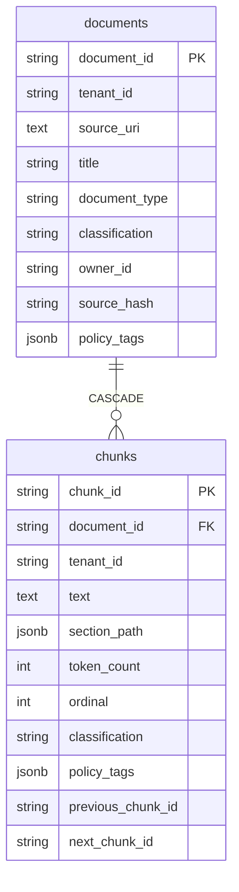
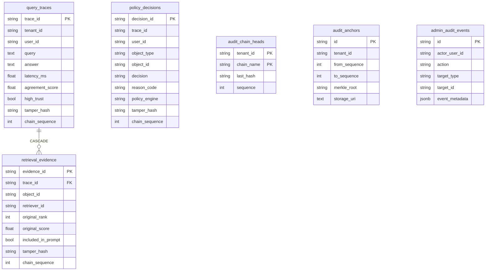

# 02 — Data Model

Four stores, one owner each: PostgreSQL owns documents/audit/identities, Qdrant owns vectors, Neo4j owns the entity graph, OpenFGA owns authorization tuples. All ORM models live in `src/securgraph/indexing/db.py` (SQLAlchemy 2 async, JSONB on PostgreSQL).

## PostgreSQL

### Content



Idempotency: unique `(tenant_id, source_uri, source_hash)` on `documents` — re-ingesting identical bytes is a no-op (`already_ingested`).

### Audit spine (C1)



Three HMAC chains per tenant (`trace`, `evidence`, `decision`), each with a `SELECT … FOR UPDATE`-locked head row in `audit_chain_heads` and a unique `(tenant_id, chain_sequence)` per table. Consensus columns on `query_traces` are deliberately **outside** the tamper hash (they are derived analytics, not evidence). Failed queries also persist a chained trace row. `admin_audit_events` records control-plane actions including permission grant/revoke and job cancel/retry.

### Identity and control plane

| Table | Purpose | Notable constraints |
| --- | --- | --- |
| `auth_users` | Global users: `password_hash`, `is_super_admin`, `must_change_password` (default true), `token_version`. | unique `username`, `email` |
| `tenants` | Tenant registry + `tenant_admin_settings_enabled` delegation flag. | status ∈ active/suspended/archived |
| `tenant_memberships` | `(tenant_id, user_id)` composite PK, per-tenant `role`. | role ∈ super_admin/tenant_admin/analyst/viewer |
| `auth_sessions` | Server-side sessions: SHA-256 hashes of refresh + CSRF tokens, revocation, expiry, UA/IP. | unique `refresh_token_hash` |
| `groups` / `group_memberships` | Tenant groups (kind functional/project) and members. | unique `(tenant_id, slug)` |
| `document_access_templates` | Per-document-type defaults: classification, owner rule, allowed groups, direct viewers; versioned. | one template per `(tenant_id, document_type)` |
| `provider_credentials` | AES-GCM-encrypted provider API keys (`encrypted_secret`, `fingerprint`, test status). | unique `(tenant_id, provider)` |
| `runtime_settings` | Tenant-scoped runtime overrides (JSONB value, version). | unique `(tenant_id, key)` |
| `model_catalog` | Models discovered on credential verification. | unique `(tenant_id, provider, model_id)` |
| `ingestion_jobs` / `ingestion_sources` / `ingestion_provenance` | Job lifecycle, AES-GCM-encrypted original upload (for retry), pipeline provenance (parser/chunker/embedder/extractor versions). | unique `idempotency_key` |
| `operation_jobs` | Ledger verify/anchor, community recompute, eval baseline jobs. | unique `idempotency_key` |

### Row-Level Security

Migration `e5f6a7b8c9d0` enables `ENABLE` + `FORCE ROW LEVEL SECURITY` with policy `tenant_isolation` on 17 tenant tables plus two correlated tables (`group_memberships` via `groups`, `ingestion_sources` via `ingestion_jobs`). Predicate (both `USING` and `WITH CHECK`):

```sql
current_setting('app.is_super_admin', true) = 'true'
  OR tenant_id = nullif(current_setting('app.tenant_id', true), '')
```

The API sets both GUCs transaction-locally per request (`set_tenant_rls_context`, `src/securgraph/api/dependencies.py`) and connects as **`securgraph_app`** — a `LOGIN NOSUPERUSER NOBYPASSRLS` role created by migration `f6a7b8c9d0e1` with DML-only grants (SELECT/INSERT/UPDATE/DELETE + sequence usage, no DDL, no TRUNCATE). Because the role cannot bypass RLS and the tables force it, tenant isolation holds even against application-level SQL mistakes. Migrations run under the separate superuser DSN.

### Migrations

Single linear Alembic chain, head `f6a7b8c9d0e1`:

| # | Revision | Adds |
| --- | --- | --- |
| 1 | `04fc0d88ee01` | documents, chunks, ingestion_jobs, ingestion_provenance |
| 2 | `a202a822bf67` | policy_decisions, query_traces, retrieval_evidence |
| 3 | `e0f1aa805a88` | `tamper_hash` columns |
| 4 | `f83c6f71153c` | auth_users |
| 5 | `b1c2d3e4f5a6` | consensus columns on query_traces |
| 6 | `c2d3e4f5a6b7` | control plane (13 tables) + `chain_sequence` + backfill |
| 7 | `d4e5f6a7b8c9` | ingestion_sources (encrypted retry payloads) |
| 8 | `e5f6a7b8c9d0` | tenant RLS policies |
| 9 | `f6a7b8c9d0e1` | `securgraph_app` least-privilege role |

Check before committing a new migration: `.venv/bin/alembic heads` must show exactly one head.

## Qdrant

- **Collection**: `securgraph_chunks` (configurable). One unnamed dense vector per point: **1024-dim, cosine** (BGE-M3).
- **Point id**: deterministic `uuid5(NAMESPACE_DNS, chunk_id)` — re-upserts are idempotent.
- **Payload**: `chunk_id`, `document_id`, `tenant_id`, `text`, `classification`, `policy_tags`.
- **Payload indexes**: keyword on `tenant_id`, `classification`, `policy_tags`; **full-text** on `text` (multilingual tokenizer, lowercased) — this powers the *lexical* retrieval lane. There are no sparse vectors; BGE-M3 is used dense-only.
- Every search hard-filters on `tenant_id`.

## Neo4j

No schema constraints are declared; uniqueness comes from `MERGE` keys that always include `tenant_id`.

| Label | Merge keys | Other properties |
| --- | --- | --- |
| `Document` | `document_id`, `tenant_id` | `classification` |
| `Chunk` | `chunk_id`, `tenant_id` | `classification`, `policy_tags`, `owner_id`, `direct_viewers` — the raw material for C3 policy-class computation |
| `Entity` | `name`, `tenant_id` | `label` |
| `Community` | `community_id`, `tenant_id` | `title`, `summary`, `level`, `member_entities`, `policy_class_key`, `source_policy_class_keys` |

| Relationship | Shape | Properties |
| --- | --- | --- |
| `CONTAINS` | Document → Chunk | — |
| `MENTIONS` | Chunk → Entity | — |
| `RELATED_TO` | Entity → Entity | `type` (merge key), `confidence`, **`source_chunk_ids`** (append-dedup list — the authorization evidence for path-cut), and after self-healing: `self_healed`, or `needs_review` + `conflict_reason` |
| `HAS_SUB_COMMUNITY` | Community(L1) → Community(L0) | same policy class only |
| `CONTAINS_ENTITY` | Community → Entity | — |

`community_id` encodes its provenance: `comm_l{level}_{idx}_{class_key}_{tenant_id}`.

## OpenFGA authorization model

DSL at `docker/openfga/model.fga` (schema 1.1), bootstrapped at startup:

```text
type user
type group
  relations
    define member: [user, group#member]        # nested groups
type document
  relations
    define owner: [user]
    define group_viewer: [group#member]
    define direct_viewer: [user]
    define viewer: owner or group_viewer or direct_viewer
type chunk
  relations
    define parent_document: [document]
    define viewer: viewer from parent_document  # chunks inherit document access
type policy_class                                # C3: one object per equivalence class
  relations
    define owner: [user]
    define group_viewer: [group#member]
    define direct_viewer: [user]
    define viewer: owner or group_viewer or direct_viewer
type community
  relations
    define in_class: [policy_class]
    define viewer: viewer from in_class          # communities inherit class access
```

Tuples written by the system:

| Written during | Tuple |
| --- | --- |
| Ingestion | `user:<owner>` → `owner` → `document:<id>`; `user:<viewer>` → `direct_viewer` → `document:<id>`; `document:<id>` → `parent_document` → `chunk:<id>` |
| Community recompute (C3) | class grants mirroring the access label (`owner` / `group:<g>#member` as `group_viewer` / `direct_viewer` → `policy_class:<key>`); `policy_class:<key>` → `in_class` → `community:<id>` |
| Admin grant/revoke | arbitrary `{user, relation, object}` via `/admin/permissions` (audited) |

All retrieval-time checks ask one question: `viewer` on `chunk:<id>`, `policy_class:<key>`, or `community:<id>`. Every check is fail-closed: adapter errors count as deny.

## Configuration surface

Environment variables (prefix `SECURGRAPH_` unless aliased) are declared in `src/securgraph/config.py`; the operational subset is documented in [07 — Deployment](07-deployment.md). Never commit `.env`; secrets (`JWT_SECRET`, `AUDIT_HMAC_KEY`, `SECURGRAPH_MASTER_KEY`, provider API keys) are SecretStr fields and are never returned by any endpoint.
