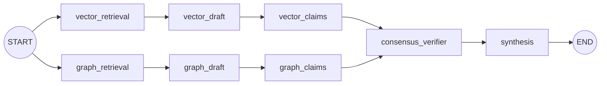

# 04 — Query Pipeline

`POST /api/v1/query` runs a LangGraph `StateGraph` with 8 nodes (`src/securgraph/orchestration/workflow.py`). Two retrieval lanes run in parallel, each produces an independent draft answer, the drafts are cross-verified by NLI, and a **code-level** verdict decides how the final answer is synthesized. All branching happens in code inside the nodes — the graph edges are static.

## Workflow topology

State fields: `query, subject, options, trace_id, vector_context, vector_draft, vector_claims, graph_context, graph_draft, graph_claims, consensus_report, final_answer, warnings`.

## 1 — Routing (`auto_route`)

When `options.retrieval_mode == "auto"`, a heuristic router inspects the query and resolves to `hybrid` with tuned parameters:

- **Lexical signal** — ticket codes (`A-12`), quoted phrases, long numbers, or minutes/action vocabulary (`action`, `minutes`, `open`, `pending`, `follow-up`, `task`) → raises `top_k` to ≥ 15.
- **Relational signal** — English and Italian relationship phrasing (`related to`, `depends on`, `collegato`, `con chi`, …) → deepens `max_graph_depth` by 1 (hard cap 4).

Explicit modes pass through untouched: `vector` and `lexical` skip the graph lane; `graph` skips the vector lane; `options.query_type == "global"` bypasses vector and consensus entirely and answers from C3 community summaries. Routing is heuristic, not learned — a documented limitation.

## 2 — Vector lane

1. **Dense search**: Qdrant cosine search over BGE-M3 embeddings (1024-dim), hard-filtered by `tenant_id`.
2. **Lexical search** (hybrid/lexical modes): Qdrant full-text `MatchText` on the chunk text payload.
3. **RRF fusion**: `score(d) = Σ 1/(k + rank + 1)` with `k = 60` (`src/securgraph/indexing/fusion.py`); dense wins ties on the same chunk.
4. **Authorization (C1)**: one OpenFGA `viewer` check per fused chunk (concurrent, fail-closed). Unauthorized chunks are dropped and **every decision — allow and deny — is persisted as a `PolicyDecisionRow` and committed before any text reaches a prompt**.
5. **Draft**: authorized chunks (deduplicated, capped at `query_token_budget`) go to the generation LLM with a strict grounding prompt ("answer ONLY from the context").

## 3 — Graph lane

1. **Seed extraction**: entity names for the tenant are fetched from Neo4j and matched against the query (case-insensitive substring, both directions); fallback to capitalized-word heuristics.
2. **Traversal**: `(seed)-[:RELATED_TO*1..depth]-(other)` with depth clamped to 1..4; each path aggregates the `source_chunk_ids` of its edges.
3. **Authorization + path-cut (C1)**: supporting chunks are batch-checked against OpenFGA. A path is **cut** if any of its edges is supported *only* by unauthorized chunks. Per-path `GRAPH_PATH` decisions are persisted (`graph_path_cut_pass` / `graph_path_cut`). Edges with no source chunks don't cut (nothing to authorize); self-healed edges inherit the chunk ids of the edge they replaced, so they remain authorizable.
4. **Draft**: reconstructed path texts (from authorized chunks only) go to the generation LLM with the same grounding prompt.

## 4 — Consensus (C2)

Each draft is decomposed into atomic claims (LLM call per lane). Then, bidirectionally, every claim from one lane is judged against the other lane's draft:

- **NLI judge**: with `SECURGRAPH_FEATURE_VERIFIER_ENSEMBLE=true`, a 3-voter ensemble — the same claim judged under three prompt/temperature variants (strict 0.0 / conservative 0.3 / factual-support 0.7), majority vote; ties prefer `neutral`, and `contradiction` beats `entailment`. Single-vote otherwise.
- **Agreement score**: `0.4 · jaccard(entity sets) + 0.6 · fraction of entailed claims`. Both-empty edge cases score 1.0.
- **`high_trust`**: `agreement ≥ consensus_threshold` (default 0.7, per-request override).

If self-healing is enabled and a graph claim is judged `contradiction`, a background repair task launches (see [05 — Ingestion](05-ingestion.md#self-healing)).

## 5 — Synthesis verdict (`decide_synthesis`)

The verdict is computed in code from evidence presence and consensus — never delegated to the LLM prompt, so refusal at high agreement is impossible by construction:

| Branch | Condition | Behavior |
| --- | --- | --- |
| `no_evidence` | both drafts empty | Honest refusal, **no LLM call**. |
| `single_channel` | exactly one draft | Answer from that channel; warning that consensus is not meaningful (UI shows an N/A badge). |
| `direct` | `high_trust` | Direct answer, no warnings. |
| `cautious` | both drafts, agreement below threshold | Answers with facts confirmed by both channels, omits conflicts, warns — but does not refuse. |

**Deterministic extraction** (`try_deterministic_synthesis`): before calling the LLM, a small set of pattern extractors returns a draft-grounded answer directly when the fact is explicit in the retrieved evidence (e.g. "Open action: …" lines in meeting minutes, "No X or Y is permitted" prohibitions, and six hardcoded query→phrase→answer templates). Guards: the answer template only fires when *both* the query matches its pattern *and* the source phrase is present in the drafts/raw authorized context — it can surface only retrieved, authorized text. **Caveat**: these templates were written against the MRD evaluation suite; they are benchmark-specific shortcuts, not a general synthesis mechanism (see [09 — Evaluation](09-evaluation.md#methodology-caveats)).

The final prompt appends grounding rules (exact amounts/dates/roles, explicit "No." for exclusions, quote governing phrases) and, for minutes-like queries, a verbatim-quoting instruction.

## 6 — Trace persistence

After the workflow returns (or throws):

- `QueryTraceRow` (query, answer, timings, consensus snapshot) + one `RetrievalEvidenceRow` per fused/traversed object with `included_in_prompt`.
- With `SECURGRAPH_AUDIT_TAMPER_EVIDENT=true`, trace, evidence, and decision rows are HMAC-chained under the per-tenant chain heads before commit.
- **Failure paths persist too**: an exception still inserts the trace row (rollback → stamp `completed_at`/`latency_ms` → chain → commit), so failed queries are auditable. The answer stays NULL.
- Response: `{answer, citations, confidence, channels, trace_id, warnings}`. Citations are built deterministically from authorized evidence → tenant-scoped `documents.source_uri`.

## Observability

Spans: `query_pipeline` → `vector_retrieval`, `graph_retrieval`, `vector_draft`, `graph_draft`, `consensus_verifier`, `synthesis`, with `securgraph.*` attributes (counts, denied counts, agreement, high_trust). Prometheus: `securgraph_query_total`, `securgraph_query_latency_seconds`, `securgraph_consensus_agreement_score`, `securgraph_policy_decision_total`, `securgraph_graph_self_healing_total`.

## Failure modes

| Failure | Behavior |
| --- | --- |
| OpenFGA unreachable | Every check denies (fail-closed) → typically `no_evidence` refusal; decisions recorded as deny. |
| One store down (Qdrant *or* Neo4j) | The healthy lane still answers → `single_channel` with warning. |
| LLM provider blocked by tenant egress policy | HTTP 451 before any provider call. |
| Workflow exception | 500 to the caller, failure trace persisted and chained. |
