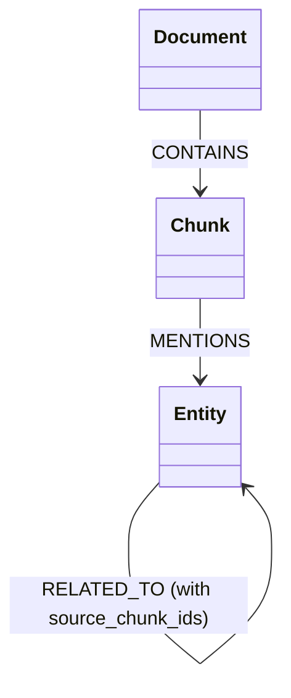

# Milestone 3: Graph Construction & Retrieval Spec

This milestone covers building the knowledge graph in Neo4j, running LLM-assisted entity/relationship extraction from ingested chunks via local Ollama (`gemma3:1b`), and executing Cypher-based retrieval traversals.

---

## 1. Neo4j Graph Schema Design

The knowledge graph models relationships between chunks, documents, and extracted domain concepts.



- **Node Types**:
  - `Document`: properties `document_id`, `tenant_id`, `title`, `classification`
  - `Chunk`: properties `chunk_id`, `tenant_id`, `classification`, `policy_tags`
  - `Entity`: properties `entity_id`, `tenant_id`, `name`, `label` (e.g. `Server`, `User`, `Project`, `Database`)
- **Relationship Types**:
  - `(:Document)-[:CONTAINS]->(:Chunk)`
  - `(:Chunk)-[:MENTIONS]->(:Entity)`
  - `(:Entity)-[:RELATED_TO {source_chunk_ids, confidence}]->(:Entity)`

---

## 2. LLM Structured Extractor (`Ollama` + `gemma3:1b`)

Entity and relationship extraction must run locally under minimal hardware configurations. We will use Pydantic and JSON structured generation with local `gemma3:1b`.

### 📝 Structured Pydantic Extraction Schema (`src/securgraph/domain/graph.py`)

```python
from __future__ import annotations
from pydantic import BaseModel, Field

class ExtractedEntity(BaseModel):
    name: str = Field(description="Normalized name of the entity")
    label: str = Field(description="Category of the entity (e.g. Server, Project, Person, Database)")

class ExtractedRelation(BaseModel):
    source_entity_name: str = Field(description="Name of the source entity")
    target_entity_name: str = Field(description="Name of the target entity")
    relationship_type: str = Field(description="Verb/predicate describing the relationship (e.g., OWNED_BY, DEPENDS_ON)")
    confidence: float = Field(description="Confidence score from 0.0 to 1.0", ge=0.0, le=1.0)

class ExtractedGraphSlice(BaseModel):
    entities: list[ExtractedEntity] = Field(default_factory=list)
    relations: list[ExtractedRelation] = Field(default_factory=list)
```

### 📝 System Prompt for Gemma3 Extraction

```
You are an expert knowledge graph extraction agent. Analyze the provided text chunk and extract all entities and their semantic relationships.
Output strictly in JSON matching this schema:
{
  "entities": [{"name": "entity_name", "label": "ENTITY_TYPE"}],
  "relations": [{"source_entity_name": "name", "target_entity_name": "name", "relationship_type": "TYPE", "confidence": 0.9}]
}
If no entities/relations are found, return empty lists. Do not write markdown blocks or text, return ONLY the raw JSON.
```

---

## 3. Cypher Transaction Writers

Write operations must be fully transactional and idempotent, linking extracted entities back to the source `chunk_id` for auditable lineage.

### 📝 Python Cypher Service (`src/securgraph/adapters/neo4j_writer.py`)

```python
from __future__ import annotations

from neo4j import AsyncDriver
from securgraph.domain import Chunk, GraphNode, GraphEdge
from securgraph.domain.graph import ExtractedGraphSlice

async def write_graph_slice(
    driver: AsyncDriver,
    tenant_id: str,
    chunk: Chunk,
    graph_slice: ExtractedGraphSlice,
) -> None:
    """UPSERT Document -> Chunk -> Entities -> Relationships in Neo4j."""
    async with driver.session() as session:
        # 1. Upsert Chunk Node and Link to Document
        chunk_cypher = """
        MERGE (d:Document {document_id: $doc_id, tenant_id: $tenant_id})
        ON CREATE SET d.classification = $classification
        
        MERGE (c:Chunk {chunk_id: $chunk_id, tenant_id: $tenant_id})
        SET c.classification = $classification,
            c.policy_tags = $policy_tags
            
        MERGE (d)-[:CONTAINS]->(c)
        """
        await session.run(
            chunk_cypher,
            doc_id=chunk.document_id,
            chunk_id=chunk.chunk_id,
            tenant_id=tenant_id,
            classification=chunk.classification.value,
            policy_tags=list(chunk.policy_tags),
        )

        # 2. Upsert Entities and Link to Chunk
        entity_cypher = """
        UNWIND $entities AS ent
        MERGE (e:Entity {name: ent.name, tenant_id: $tenant_id})
        ON CREATE SET e.label = ent.label
        
        WITH e
        MATCH (c:Chunk {chunk_id: $chunk_id, tenant_id: $tenant_id})
        MERGE (c)-[:MENTIONS]->(e)
        """
        await session.run(
            entity_cypher,
            entities=[e.model_dump() for e in graph_slice.entities],
            tenant_id=tenant_id,
            chunk_id=chunk.chunk_id,
        )

        # 3. Upsert Relationships between Entities
        rel_cypher = """
        UNWIND $relations AS rel
        MATCH (src:Entity {name: rel.source_entity_name, tenant_id: $tenant_id})
        MATCH (tgt:Entity {name: rel.target_entity_name, tenant_id: $tenant_id})
        
        MERGE (src)-[r:RELATED_TO {type: rel.relationship_type}]->(tgt)
        SET r.confidence = rel.confidence,
            r.source_chunk_ids = apoc.coll.toSet(coalesce(r.source_chunk_ids, []) + [$chunk_id])
        """
        await session.run(
            rel_cypher,
            relations=[r.model_dump() for r in graph_slice.relations],
            tenant_id=tenant_id,
            chunk_id=chunk.chunk_id,
        )
```

---

## 4. Traversal Retrieval Engine

Query traversal fetches surrounding entities and relationships up to `N` hops deep, filtering paths by tenant bounds.

### 📝 Python Retrieval Cypher (`src/securgraph/indexing/graph_retriever.py`)

```python
from neo4j import AsyncDriver
from securgraph.domain import GraphNode, GraphEdge, GraphPath

class Neo4jGraphRetriever:
    def __init__(self, driver: AsyncDriver) -> None:
        self.driver = driver

    async def traverse_subgraph(
        self, tenant_id: str, seed_entities: list[str], max_depth: int = 2
    ) -> list[GraphPath]:
        """Fetch all entities and relationships traversed from the seed nodes."""
        cypher = """
        MATCH (seed:Entity {tenant_id: $tenant_id})
        WHERE seed.name IN $seeds
        
        MATCH path = (seed)-[r:RELATED_TO*1..2]-(other:Entity {tenant_id: $tenant_id})
        
        RETURN 
            [n in nodes(path) | {id: n.name, label: labels(n)[0], name: n.name}] AS path_nodes,
            [rel in relationships(path) | {
                id: elementId(rel), 
                source: startNode(rel).name, 
                target: endNode(rel).name, 
                type: rel.type,
                source_chunk_ids: rel.source_chunk_ids
            }] AS path_edges
        """
        async with self.driver.session() as session:
            result = await session.run(cypher, tenant_id=tenant_id, seeds=seed_entities)
            
            paths = []
            async for record in result:
                # Map records to GraphPath domain object (Pydantic)
                nodes = tuple(n["id"] for n in record["path_nodes"])
                edges = tuple(e["id"] for e in record["path_edges"])
                paths.append(
                    GraphPath(
                        path_id=f"path_{hash(nodes)}",
                        nodes=nodes,
                        edges=edges,
                        confidence=1.0,
                    )
                )
            return paths
```
