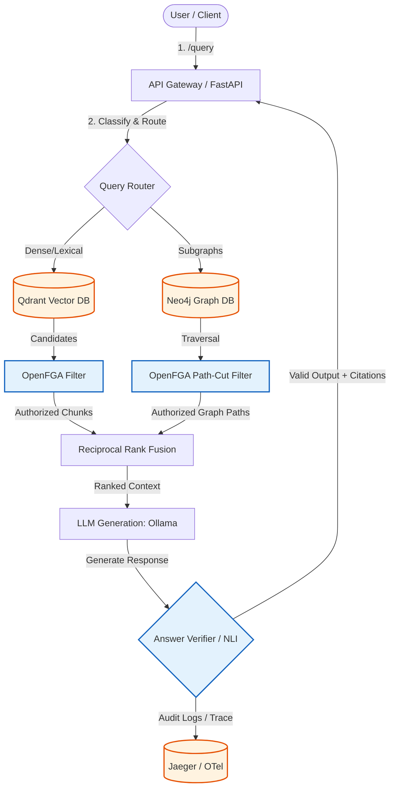

# SecureGraph RAG Framework Development Plan

SecureGraph is a modular, high-security RAG framework designed for regulated environments. It enforces fine-grained access control (ReBAC) on vector and graph databases *before* LLM generation, records complete W3C PROV-compliant explainability traces, and performs claim-level NLI verification.

## 🏗 High-Level Architecture

---

## 📈 Development Milestone Map

Below is the structured roadmap for executing the remaining engineering layers:

| Code | Milestone | Core Objective | Key Backend |
|---|---|---|---|
| **M1** | Ingestion & Metadata | Build sync `/ingest` routes, Alembic migrations, real-ping health probes, and integration test coverage. | Async PostgreSQL (`asyncpg`) |
| **M2** | Vector Retrieval | Setup Qdrant collections, implement local `BAAI/bge-m3` embedding adapters, write vector indexing pipelines, and dense/lexical fusion queries. | Qdrant |
| **M3** | Graph Construction | Build LLM-assisted schema extraction using local Ollama, write relational triples (`Entity`-`REL`-`Entity`), and run relational traversal retrievals. | Neo4j |
| **M4** | ReBAC Enforcement | Author DSL models, mount candidate post-filtering, and enforce path-cut Graph perimeters before retrieval. | OpenFGA |
| **M5** | Fusion & Generation | Implement query intent classifiers, Reciprocal Rank Fusion (RRF), token budgeting, local Ollama generation, and dynamic citation builders. | Ollama (`gemma3:1b`) |
| **M6** | Provenance & Explain | Build relational DB schemas mapping entity lineage, W3C PROV-O traces, and queryable `/explain/{trace_id}` endpoint. | PostgreSQL |
| **M7** | Audit & Observability | Instrument end-to-end distributed tracing spans (OTel) to Jaeger, compute metrics, and add NLI claim-evidence verification. | Jaeger / Prometheus |
| **M8** | Pilot & Evaluation | Launch golden set evaluators (Ragas), perform adversarial stress tests, leakage validations, and deployment automation. | Ragas / Docker |

---

## 📂 Plan Directory Structure

The subsequent planning specifications are structured as follows:

1. [01_ingestion_and_metadata.md](plan/01_ingestion_and_metadata.md) — API router completion, Alembic setup, live database testing.
2. [02_vector_and_lexical_retrieval.md](plan/02_vector_and_lexical_retrieval.md) — Qdrant setup, BGE-M3 integration, dense/lexical indexing.
3. [03_graph_extraction_and_retrieval.md](plan/03_graph_extraction_and_retrieval.md) — Neo4j integration, LLM-based triples extraction, Cypher traversal query signatures.
4. [04_policy_enforcement.md](plan/04_policy_enforcement.md) — OpenFGA ReBAC DSL authorization, post-filtering, and path-cut algorithms.
5. [05_hybrid_fusion_and_generation.md](plan/05_hybrid_fusion_and_generation.md) — Query classifier, RRF fusion, local LLM generation, and citation rendering.
6. [06_provenance_and_explainability.md](plan/06_provenance_and_explainability.md) — SQL provenance tables, lineage persistence, `/explain` contract.
7. [07_observability_and_verification.md](plan/07_observability_and_verification.md) — OpenTelemetry tracer configuration, Prometheus metrics, and claim checker.
8. [08_pilot_and_evaluation.md](plan/08_pilot_and_evaluation.md) — Golden datasets, leakage validation, Ragas performance metrics.
